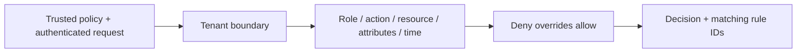

# Tenant Policy Engine

An educational, tenant-aware policy evaluator for Python backend and security portfolios. It demonstrates explicit authorization decisions, deny-overrides behavior and reproducible time windows without connecting to an identity provider.



## Run

```bash
uv sync --frozen
uv run policy-check examples/policy.yml examples/request.json
uv run uvicorn policy_engine.api:app --reload
uv run pytest -q
```

Swagger UI: http://127.0.0.1:8000/docs. `POST /evaluate` accepts an object with `policy` and `request`, matching the example files. The CLI exits 0 for allow, 1 for deny, and 2 for malformed input. `GET /health` is a process health check.

## Decision semantics

- Different tenant IDs always deny, even when an allow rule matches.
- No matching rule means deny. Any matching deny overrides all matching allows.
- Roles match exact strings, or `*` for any supplied role. Subjects with no roles never match.
- Action and resource patterns use Python `fnmatchcase` shell-pattern semantics, not regex; matching is case sensitive.
- Required attributes use exact string equality. Missing attributes do not match.
- Time bounds use timezone-aware ISO timestamps: start is inclusive, end is exclusive. Callers explicitly supply the decision instant for replayability.
- Invalid fields, unknown keys, duplicate rule IDs and inverted time windows are rejected. Returned rule IDs are sorted for stable diagnostics.

## Security boundary and limitations

The HTTP endpoint is an evaluator playground, not an authorization gateway: callers supply the policy, roles, tenant IDs, attributes and timestamp. Never trust these values directly from an untrusted client. A real integration must obtain identity claims from validated authentication, load operator-controlled policy, choose server time, enforce the decision on every protected operation and protect audit logs. No JWT validation, policy storage, network enforcement or multi-process deployment is implemented. Diagnostic rule IDs can reveal policy structure; do not expose them to untrusted clients unchanged.

Use synthetic identities only. The CLI reads trusted local YAML with `safe_load`; no network I/O occurs during evaluation. Tests cover tenant boundaries, deny precedence, attribute failures, timezone equivalence, time edges, invalid policies, API validation and CLI exit behavior.

## Container

```bash
docker build -t tenant-policy-engine .
docker run --rm -p 127.0.0.1:8000:8000 tenant-policy-engine
```

The image runs as a non-root user. This repository is a demonstration, not a security certification or evidence of production deployment.
